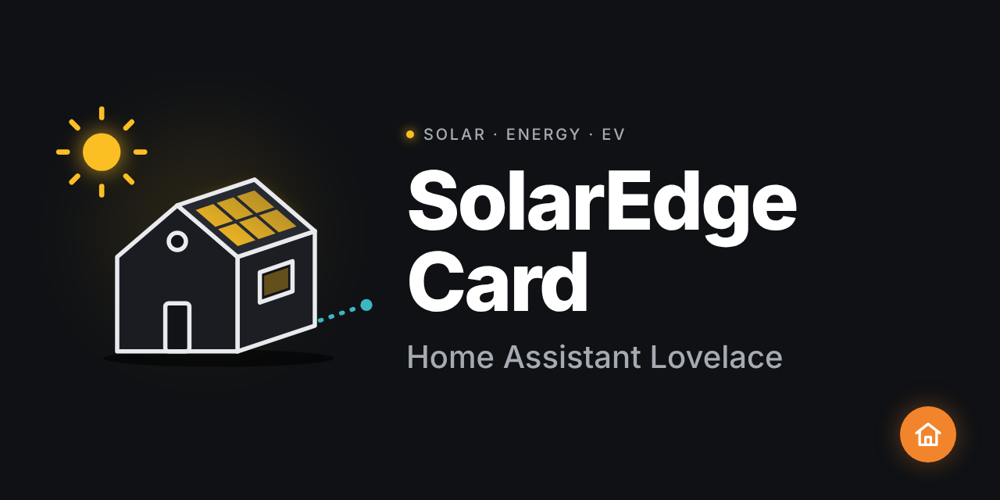

# ha-solaredge-card

[](https://github.com/hacs/integration)
[](https://my.home-assistant.io/redirect/hacs_repository/?owner=HOMELAB-IA&repository=ha-solaredge-card&category=plugin)

Carte Lovelace Home Assistant pour le suivi de la production solaire SolarEdge et la charge du véhicule électrique. Affiche une scène 3D animée avec les flux d'énergie en temps réel (mode jour/nuit automatique).

[](https://github.com/HOMELAB-IA/ha-solaredge-card)

## Installation via HACS

1. Ouvrir HACS → Frontend → Menu ⋮ → Dépôts personnalisés
2. Ajouter `https://github.com/HOMELAB-IA/ha-solaredge-card` (catégorie : Plugin)
3. Installer **SolarEdge Card**
4. Vider le cache du navigateur

Ou cliquer sur le bouton :

[](https://my.home-assistant.io/redirect/hacs_repository/?owner=HOMELAB-IA&repository=ha-solaredge-card&category=plugin)

## Configuration

```yaml
type: custom:solaredge-card
solar_power: sensor.hautier_pascal_sso_meter_solar_power
grid_power: sensor.hautier_pascal_sso_meter_grid_power
consumption: sensor.hautier_pascal_sso_meter_consumption
# Options
ev_power: sensor.voldt_puissance
ev_switch: switch.voldt_recharge
ev_battery: sensor.garage_a390gt_batterie
ev_name: A390 GT
```

## Paramètres

| Paramètre | Obligatoire | Description |
|---|---|---|
| `solar_power` | Oui | Production solaire (W ou kW) |
| `grid_power` | Oui | Échange réseau — `>0` = import, `<0` = export (W ou kW) |
| `consumption` | Oui | Consommation totale maison + VE (W ou kW) |
| `ev_power` | Non | Puissance de charge du VE (W ou kW) |
| `ev_switch` | Non | Switch on/off borne de charge |
| `ev_battery` | Non | Niveau batterie VE en % |
| `ev_name` | Non | Nom du véhicule affiché (défaut : `VE`) |
| `connectivity` | Non | `binary_sensor` connectivité onduleur |
| `alerts` | Non | Nombre d'alertes onduleur |

## Flux affichés

| Flux | Couleur | Mode |
|---|---|---|
| Panneaux → Onduleur | Jaune `#f5a524` | Jour |
| Onduleur → Réseau (export) | Cyan `#2fb3c0` | Jour |
| Onduleur → Maison & VE | Vert `#3ccf7e` | Jour |
| Réseau → Maison & VE (import) | Orange `#f59e4b` | Nuit |

Le mode jour s'active automatiquement quand la production solaire dépasse 0,1 kW.

## Entités compatibles

Testé avec l'intégration [SolarEdge](https://www.home-assistant.io/integrations/solaredge/) et l'intégration OCPP/Voldt pour la recharge VE.
